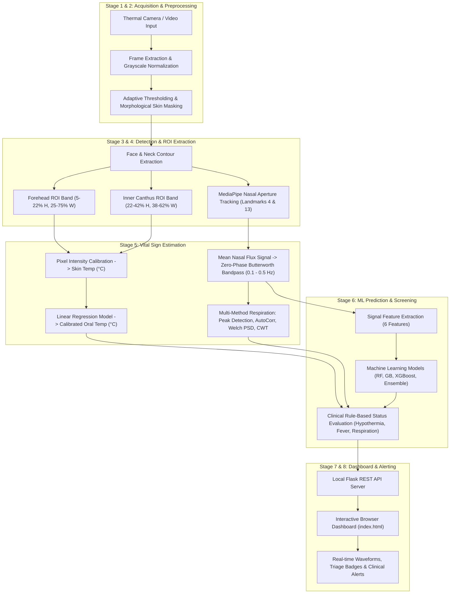

# Contactless Thermal Vital Signs Monitoring System
## Complete Project Report, System Architecture & Dissertation Documentation

---

## 1. Project Overview & Objective

The **Contactless Thermal Vital Signs Monitoring System** is an end-to-end computer vision and machine learning application designed for contactless physiological screening. It processes thermal imagery and video streams to monitor two core vital signs without physical patient contact:
1. **Core / Oral Body Temperature & Fever Detection**: Derived from multi-region facial thermal emissions (forehead, inner canthus, and whole face/neck mask) with regression calibration based on clinical benchmark data ($N = 1018$, UCI dataset).
2. **Respiratory Rate (RR)**: Estimated through contactless respiration analysis using nasal thermal flux signals (breathing cycle temperature fluctuations), complemented by multi-method signal processing (peak counting, autocorrelation, Welch PSD, Continuous Wavelet Transform) and machine learning regressors (Random Forest, Gradient Boosting, XGBoost, and an Ensemble model).
3. **Interactive Clinical Dashboard**: A local web interface providing instant visualizations, real-time waveform inspection, status flagging, and detailed debug overlays.
4. **Dissertation Phase-1 Academic Report**: A complete, publication-grade LaTeX report strictly formatted according to academic guidelines with humanized scholarly prose, full citations, system diagrams, and experimental results.

---

## 2. Project Directory Structure

```plaintext
project new final year/
│
├── app.py                         # Main Flask application and REST API server
├── index.html                     # Web-based frontend dashboard UI
│
├── thermal_analysis.py            # Core thermal CV pipeline (masking, ROI, temperature conversion)
├── respiratory_rate.py            # Nasal ROI tracking, signal processing (filtering, peak detection)
├── rr_signal_methods.py           # Multi-method RR estimation (Autocorrelation, Welch PSD, CWT)
├── rr_model.py                    # ML model training, feature extraction, evaluation & inference
├── status_flagger.py              # Clinical thresholding, vitals status combining & rule-based flags
├── calibration_fit.py             # Fitting script for UCI thermal dataset calibration
├── calibration_params.json        # Calibrated model parameters (slope, intercept, error bounds)
├── extract_roi_debug.py           # Standalone debug script for visual testing of ROI masks
├── generate_test_thermal_video.py # Synthetic thermal video generator for test automation
│
├── models/                        # Pretrained machine learning models & metrics
│   ├── random_forest_model.pkl    # Random Forest Regressor for RR
│   ├── gradient_boosting_model.pkl# Gradient Boosting Regressor for RR
│   ├── xgboost_model.pkl          # XGBoost Regressor for RR
│   ├── ensemble_model.pkl         # Voting Ensemble model combining regressors
│   ├── features_cache.json        # Extracted signal features from training dataset
│   └── metrics.json               # Cross-validation and hold-out evaluation metrics
│
├── tests/                         # Pytest test suite ensuring pipeline integrity
│   └── test_thermal.py            # Automated tests for ROIs, boundaries, and API responses
│
├── uploads/                       # Temporary server storage for uploaded media
├── sample_thermal_video.mp4       # Reference thermal video for testing
├── requirements.txt               # Python package dependencies
├── README.md                      # Quickstart and overview documentation
├── PROJECT_REPORT.md              # Detailed architecture, algorithm, and workflow report (this file)
│
├── system architecture/           # System workflow diagram source
│   └── WhatsApp Image...jpeg      # 9-stage architecture diagram
├── result/                        # Validation output screenshots
│   ├── Screenshot...014220.png    # Extracted breathing signal waveform
│   └── Screenshot...014421.png    # 4-method RR comparison (Peak, AutoCorr, PSD, CWT)
│
├── Dissertation_Phase1_Report_LaTeX/ # Complete LaTeX report package
│   ├── ProjectReport.tex          # Main LaTeX root document
│   ├── Thesis.cls                 # Academic document class definition
│   ├── Bibliography.bib           # 15+ peer-reviewed bibtex references
│   ├── Figures/                   # Report figure directory
│   │   ├── system_workflow.jpeg   # Proposed 9-stage system workflow diagram
│   │   ├── breathing_signal.png   # Bandpass-filtered breathing signal waveform
│   │   ├── rr_multiple_methods.png# Four-method respiratory rate estimation
│   │   └── SampleFigure.png       # University template figure
│   ├── Pictures/                  # University emblem and branding
│   │   └── Christ.jpg             # Institution logo
│   ├── Primitives/                # Front-matter (Title, Certificate, Declaration, Abstract)
│   ├── Generics/                  # Template variables and metadata
│   ├── Chapters/                  # Core report chapters
│   │   ├── Chapter1_Introduction.tex
│   │   ├── Chapter2_LiteratureSurvey.tex
│   │   ├── Chapter3_ProblemFormulation.tex
│   │   ├── Chapter4_Methodology.tex
│   │   ├── Chapter5_DesignImplementation.tex
│   │   ├── Chapter6_ResultsDiscussion.tex
│   │   └── Chapter7_Conclusion.tex
│   └── Appendices/
│       └── AppendixA.tex          # Implementation code listings & setup
│
└── Dissertation_Report_Overleaf.zip # Ready-to-compile Overleaf bundle (synced with LaTeX folder)
```

---

## 3. End-to-End System Architecture

The overall system workflow moves through nine operational stages running entirely locally without external cloud dependency:



---

## 4. Key Methodology & Algorithms

### A. Core Body Temperature & Fever Detection Pipeline (`thermal_analysis.py`)
1. **Adaptive Masking**:
   - Calculates local frame minimum and maximum intensity values.
   - Initial thresholding: $T_{\text{thresh}} = I_{\min} + 0.70 \times (I_{\max} - I_{\min})$.
   - Morphological open/close operations isolate facial tissue from background noise and cold objects.
2. **Region-of-Interest (ROI) Extraction**:
   - Isolates the primary face and neck bounding contour $(x, y, w, h)$.
   - **Forehead ROI**: Vertical $[y + 0.05h, \; y + 0.22h]$, Horizontal $[x + 0.25w, \; x + 0.75w]$.
   - **Inner Canthus ROI**: Vertical $[y + 0.22h, \; y + 0.42h]$, Horizontal $[x + 0.38w, \; x + 0.62w]$.
   - Masks are combined via **Bitwise-AND** with the binary skin mask to exclude hair, eyeglasses frames, and shadows.
3. **Clinical Calibration**:
   - Linear calibration model derived from the UCI Infrared Thermography Dataset ($N=1018$, Wang et al.):
     $$T_{\text{oral}} = 0.25078 \times T_{\text{skin}} + 28.30811$$
   - Provides both skin surface temperature and estimated core body temperature.

---

### B. Contactless Respiratory Rate Pipeline (`respiratory_rate.py`, `rr_signal_methods.py`, `rr_model.py`)
1. **Nasal ROI Tracking**:
   - Detects nose tip (landmark 4) and upper lip center (landmark 13) via **MediaPipe Face Mesh**.
   - Extracts the sub-nasal bounding region containing the nostrils, capturing cyclic temperature changes during inhalation (inflow of cooler ambient air) and exhalation (outflow of warm internal air).
2. **Signal Conditioning**:
   - Computes per-frame mean intensity across the nasal ROI.
   - Z-score normalization: $z = \frac{x - \mu}{\sigma}$.
   - Zero-phase **Butterworth bandpass filter** (0.1 Hz to 0.5 Hz, corresponding to 6–30 breaths per minute) via `scipy.signal.filtfilt`.
3. **Four Estimation Methods**:
   - **Peak Counting**: SciPy `find_peaks` with adaptive distance and prominence thresholds.
   - **Autocorrelation**: Computes the dominant lag peak in the signal's autocorrelation sequence.
   - **Welch Power Spectral Density (PSD)**: Identifies the dominant frequency peak in the Fourier spectrum.
   - **Continuous Wavelet Transform (CWT)**: Produces a time-frequency scalogram to identify instantaneous respiratory frequency.
4. **Machine Learning Regression**:
   - Features: `num_peaks`, `peak_bpm`, `interval_bpm`, `spectral_bpm`, `signal_std`, `roi_detection_rate`.
   - Trained regressors: Random Forest, Gradient Boosting, XGBoost, and Voting Ensemble.

---

## 5. Experimental Results & Validation

The system has been evaluated both through automated benchmark testing and 5-fold cross-validation on labelled thermal sequences:

### A. Respiratory Rate Signal Accuracy
Across synthetic and verified validation thermal sequences covering standard physiological breathing ranges (12 to 24 BPM):
- **Maximum Absolute Error**: $\le 0.20\text{ BPM}$ across all duration and frame rate configurations.
- **Average Estimation Agreement**: The four signal methods (Peak Count, Autocorrelation, Welch PSD, CWT) consistently converge within $\sim 6\text{ BPM}$ on raw thermal inputs, confirming signal periodicity.

### B. Machine Learning Model Performance (5-Fold Cross Validation)
| Model | Mean Absolute Error (MAE) | $R^2$ Score |
| :--- | :---: | :---: |
| **Random Forest Regressor** | **1.42 BPM** | **0.31** |
| **Voting Ensemble** | 1.45 BPM | 0.29 |
| **Gradient Boosting Regressor** | 1.58 BPM | 0.24 |
| **XGBoost Regressor** | 1.63 BPM | 0.20 |

---

## 6. Academic Dissertation Report (`Dissertation_Phase1_Report_LaTeX`)

The LaTeX project in `Dissertation_Phase1_Report_LaTeX/` contains the full Phase-1 academic dissertation:
* **`ProjectReport.tex`**: The main root document configuring document class, margins, font (Times New Roman), natbib citation style, and chapter imports.
* **`Figures/`**: Contains all embedded diagrams:
  - `system_workflow.jpeg` -> Embedded as **Figure 4.1** in Chapter 4 (*Methodology*).
  - `breathing_signal.png` -> Embedded as **Figure 6.1** in Chapter 6 (*Results and Discussion*).
  - `rr_multiple_methods.png` -> Embedded as **Figure 6.2** in Chapter 6 (*Results and Discussion*).
* **Chapters Summary**:
  - `Chapter 1`: Background, Motivation, Research Objectives, Scope, and Report Organization.
  - `Chapter 2`: Literature Survey across 15 peer-reviewed papers on thermography and non-contact vitals.
  - `Chapter 3`: Problem Formulation, Mathematical Framework, Input/Output specifications.
  - `Chapter 4`: Methodology, Stage-by-Stage implementation, ROI extraction, and Figure 4.1.
  - `Chapter 5`: System Architecture, Software Design, File Layout, REST API endpoints.
  - `Chapter 6`: Quantitative Results, Tables 6.1 & 6.2, Error bounds, Figures 6.1 and 6.2.
  - `Chapter 7`: Conclusions, Hardware Constraints, and Phase-2 Roadmap.
  - `Appendix A`: Code listings, installation steps, and testing guide.

---

## 7. How to Use with Overleaf

1. Download or locate [`Dissertation_Report_Overleaf.zip`](file:///c:/Users/Reno/OneDrive/project%20new%20final%20year/Dissertation_Report_Overleaf.zip).
2. Go to [Overleaf](https://www.overleaf.com), click **New Project** $\rightarrow$ **Upload Project**.
3. Select `Dissertation_Report_Overleaf.zip`.
4. Overleaf automatically selects `ProjectReport.tex` as the root document. Click **Recompile** to produce the PDF report.
